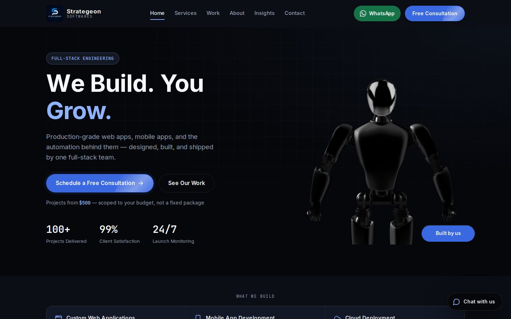
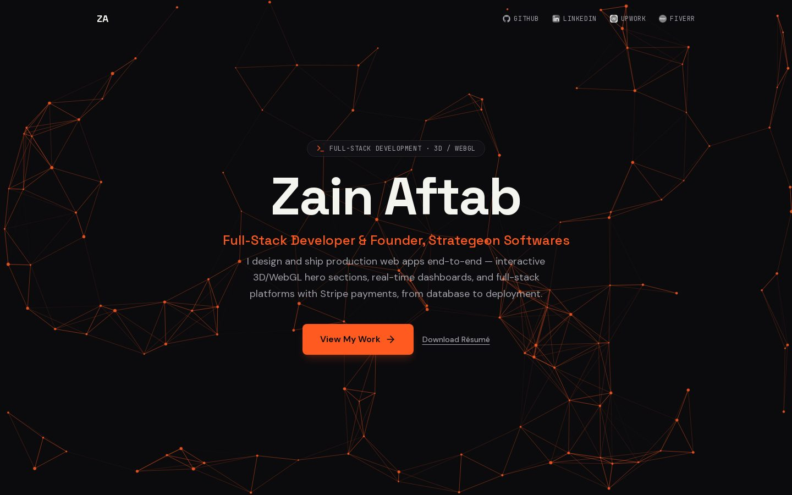
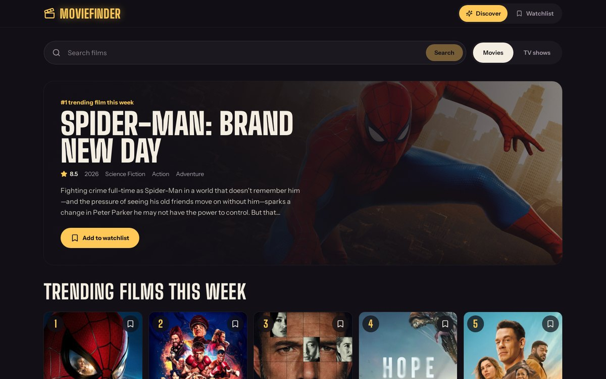
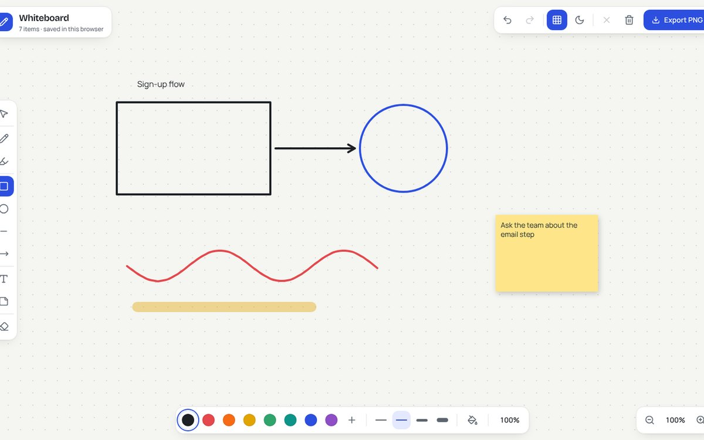

  
  
  

## About me

I'm a full-stack engineer and a Software Engineering student at **COMSATS University Islamabad, Lahore Campus**. I run **[Strategeon Softwares](https://strategeonsoftwares.com)**, a web development agency, registered as an LLC in Florida, that builds production software for clients in the US and the UK.

- 🚀 **Nine production applications shipped**, including an 18-module hospital management system, a hotel booking platform, a healthcare scheduler, a restaurant QR-ordering system, and finance and logistics dashboards
- 🧱 Most at home with **Next.js, React, Node.js / NestJS, TypeScript and PostgreSQL**, plus Docker and Stripe in production
- ✨ I also build interactive front ends with **GSAP, Framer Motion and Three.js / WebGL**
- 🔬 Interested in **machine learning and undergraduate research**. I'm open to research collaborations
- 📫 The quickest way to reach me is **[LinkedIn](https://www.linkedin.com/in/zain-aftab-563727295/)**

## Featured work

<table>
  <tr>
    <td width="50%" valign="top">
      
      <h3>🌐 Strategeon Softwares</h3>
      
My agency's website. Statically generated pages, an interactive 3D robot hero, and Sage, an AI assistant that answers visitor questions about services, process and pricing.

      
<a href="https://strategeonsoftwares.com"><b>Live site</b></a> · <a href="https://github.com/ZainAftab-dev/strategeon-softwares">Code</a>

      
<code>Next.js 16</code> <code>React 19</code> <code>Spline 3D</code> <code>Groq LLM</code>

    </td>
    <td width="50%" valign="top">
      
      <h3>🏥 ZM Hospital Management System</h3>
      
Hospital operations platform covering patients, doctors, appointments, pharmacy dispensing, billing with PDF invoices and analytics. NestJS REST API with JWT auth and role-based access control, SQL Server through Prisma, one-command Docker setup.

      
<a href="https://hospital-management-system-react-ap.vercel.app"><b>Live demo</b></a> · <a href="https://github.com/ZainAftab-dev/Hospital-Management-System-React">Code</a>

      
<code>Next.js</code> <code>NestJS</code> <code>Prisma</code> <code>SQL Server</code> <code>Docker</code>

    </td>
  </tr>
  <tr>
    <td width="50%" valign="top">
      
      <h3>💸 FinanceIQ</h3>
      
AI-powered personal finance dashboard. Turns raw bank statements into spending trends, fraud detection (Isolation Forest), subscription tracking, budgets and a conversational AI assistant.

      
<a href="https://github.com/ZainAftab-dev/Personal-Finance-Manager"><b>Code</b></a>

      
<code>Python</code> <code>Streamlit</code> <code>scikit-learn</code> <code>Plotly</code> <code>Claude API</code>

    </td>
    <td width="50%" valign="top">
      
      <h3>✨ Developer Portfolio</h3>
      
My personal site, with a custom canvas particle-network hero, bento project showcase, a balanced masonry testimonials wall and live GitHub stats.

      
<a href="https://zainaftab-dev.vercel.app"><b>Live site</b></a> · <a href="https://github.com/ZainAftab-dev/Portfolio">Code</a>

      
<code>Next.js 16</code> <code>TypeScript</code> <code>Tailwind</code> <code>Framer Motion</code>

    </td>
  </tr>
  <tr>
    <td width="50%" valign="top">
      
      <h3>🎬 MovieFinder</h3>
      
Search movies and TV shows, browse this week's trending titles and keep a watchlist. Late-night cinema design with a featured hero and ranked poster grid.

      
<a href="https://moviefinder-zain.vercel.app"><b>Live demo</b></a> · <a href="https://github.com/ZainAftab-dev/Movie-Search-App">Code</a>

      
<code>Next.js</code> <code>TypeScript</code> <code>Tailwind</code> <code>TMDB API</code>

    </td>
    <td width="50%" valign="top">
      
      <h3>🖊️ Digital Whiteboard</h3>
      
Browser whiteboard on the HTML Canvas: pen, highlighter, shapes, arrows, text, sticky notes, eraser, undo/redo, zoom, keyboard shortcuts, PNG export and auto-save.

      
<a href="https://digital-whiteboard-zain.vercel.app"><b>Live demo</b></a> · <a href="https://github.com/ZainAftab-dev/Digital-Whiteboard-App">Code</a>

      
<code>Next.js</code> <code>TypeScript</code> <code>Canvas API</code>

    </td>
  </tr>
</table>

### More projects

| Project | What it is | Stack | Links |
|---|---|---|---|
| 🛒 **Strategeon Store** | UK e-commerce storefront for networking hardware with Stripe Checkout payments | Next.js, React, Stripe | [Live](https://strategeon-llc.vercel.app) · [Code](https://github.com/ZainAftab-dev/StrategeonLLC) |
| 🤖 **End-to-End ML Systems** | Titanic survival and heart disease predictors, from raw data to a deployed web app | Python, scikit-learn, Streamlit | [Live](https://zain-aic354-ml-systems.streamlit.app) · [Code](https://github.com/ZainAftab-dev/aic354-ml-systems) |
| 💎 **Diamond Price Prediction** | Compares five regression models with 10-fold cross-validation and deploys the best (Extra Trees) | Python, scikit-learn, Streamlit | [Live](https://zainaftab-diamond-price.streamlit.app) · [Code](https://github.com/ZainAftab-dev/diamond_price_model) |
| 🌤️ **Weathercast** | Weather app whose sky follows the real conditions, with a sun arc, hourly curve and 5-day outlook | Next.js, OpenWeather API | [Live](https://weathercast-zain.vercel.app) · [Code](https://github.com/ZainAftab-dev/Weather-App) |
| 🗺️ **Smart Navigation System** | Lahore route planner using Dijkstra's algorithm with live traffic; C++ console app and web map | C++, JavaScript | [Live](https://lahore-route-planner.vercel.app) · [Code](https://github.com/ZainAftab-dev/Smart-Navigation-System) |
| ♟️ **Chess with AI** | Desktop chess against a Minimax / Alpha-Beta engine with four strength levels | Java, Swing | [Code](https://github.com/ZainAftab-dev/Chess-Game) |
| 🏥 **HMS Desktop** | Java Swing version of the hospital system with PDF invoices and file storage | Java, Swing | [Code](https://github.com/ZainAftab-dev/hospital-management-system) |
| 🧮 **Scientific Calculator** | Desk-calculator UI with LCD display, memory keys and paper-tape history | Next.js, React | [Live](https://scientific-calculator-zain.vercel.app) · [Code](https://github.com/ZainAftab-dev/Scientific-Calculator-With-React) |
| 🧠 **Memory Game** | Card-matching game with two board sizes, timer, streaks and best scores | Next.js, Tailwind | [Live](https://memory-game-zain.vercel.app) · [Code](https://github.com/ZainAftab-dev/Memory-Game) |
| 🧮 **Tkinter Calculator** | Desktop scientific calculator with DEG/RAD modes and a history tape | Python, Tkinter | [Code](https://github.com/ZainAftab-dev/Scientific-Calculator) |

## Tech stack

  
   
  
   
  

**Also used in production:** Stripe payments, JWT and role-based auth, REST API design, SQL Server and Azure SQL, GSAP, Framer Motion, WebGL.

  Building something and need a team? <a href="https://strategeonsoftwares.com">Strategeon Softwares</a> takes on web projects for startups and small businesses.

