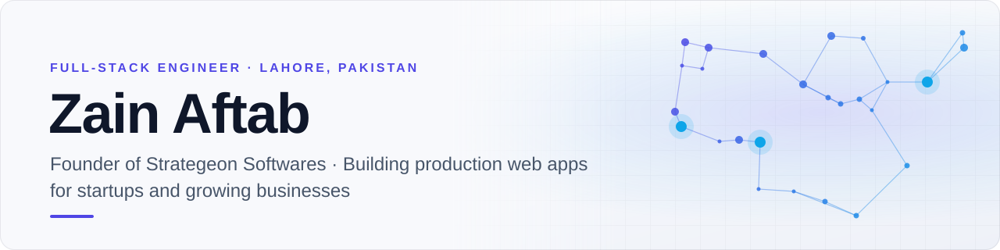
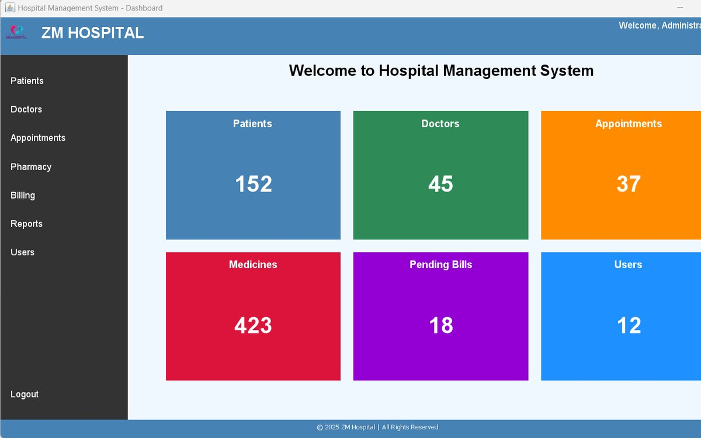
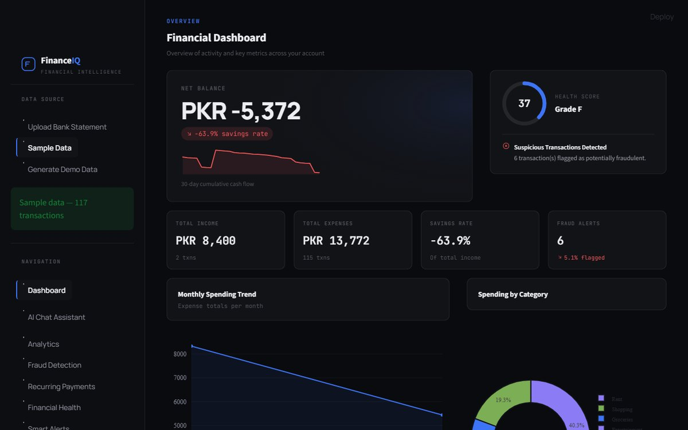
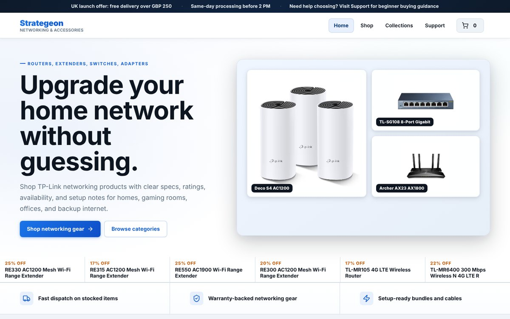
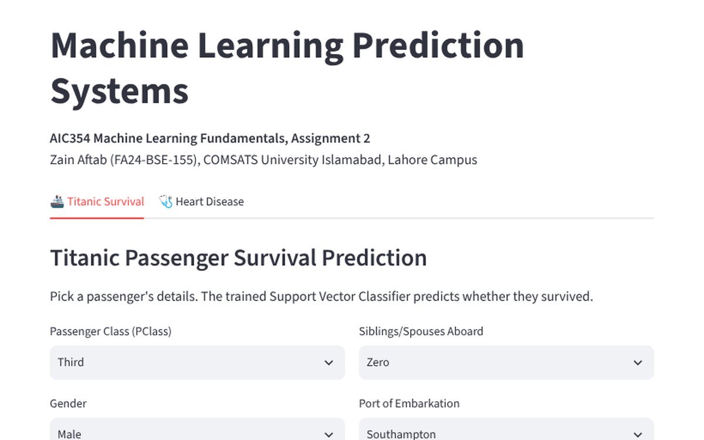
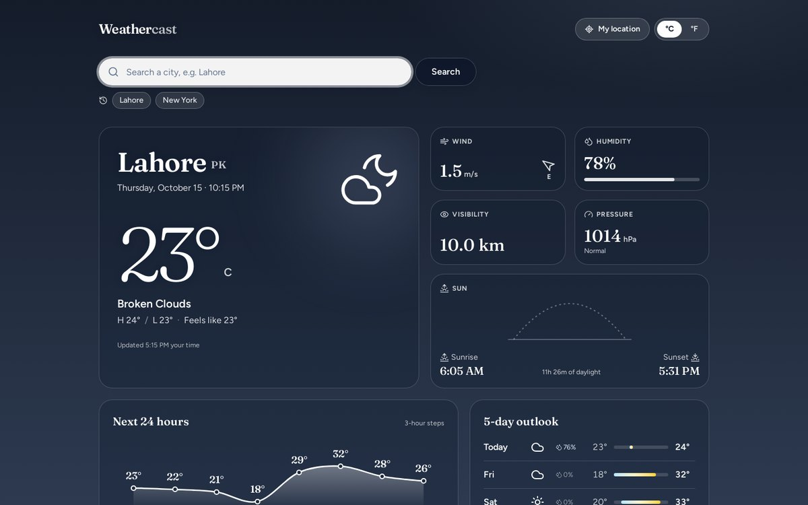
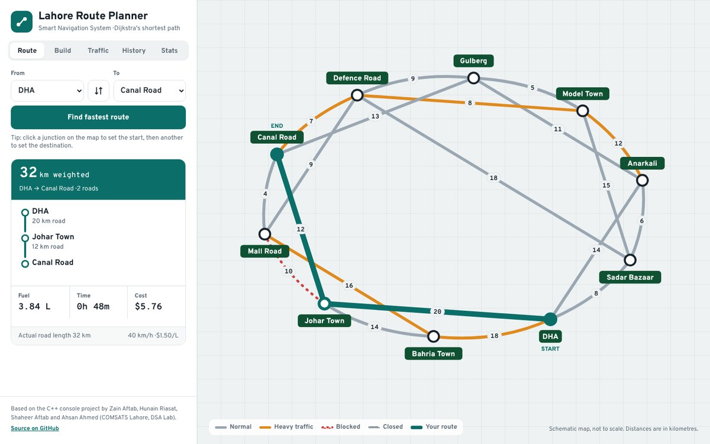

  
  
  

## About me

I'm a full-stack engineer and a Software Engineering student at **COMSATS University Islamabad, Lahore Campus**. I run **[Strategeon Softwares](https://strategeonsoftwares.com)**, a web development agency, registered as an LLC in Florida, that builds production software for clients in the US and the UK.

- 🚀 **Nine production applications shipped**, including an 18-module hospital management system, a hotel booking platform, a healthcare scheduler, a restaurant QR-ordering system, and finance and logistics dashboards
- 🧱 Most at home with **Next.js, React, Node.js / NestJS, TypeScript and PostgreSQL**, plus Docker and Stripe in production
- ✨ I also build interactive front ends with **GSAP, Framer Motion and Three.js / WebGL**
- 🔬 Interested in **machine learning and undergraduate research**. I'm open to research collaborations
- 📫 The quickest way to reach me is **[LinkedIn](https://www.linkedin.com/in/zain-aftab-563727295/)**

## Featured work

<table>
  <tr>
    <td width="50%" valign="top">
      
      <h3>🏥 ZM Hospital Management System</h3>
      
Hospital operations platform covering patients, doctors, appointments, pharmacy, billing and analytics. Next.js front end, NestJS REST API with JWT auth and role-based access control, SQL Server through Prisma.

      
<a href="https://hospital-management-system-react-ap.vercel.app"><b>Live demo</b></a> · <a href="https://github.com/ZainAftab-dev/Hospital-Management-System-React">Web version</a> · <a href="https://github.com/ZainAftab-dev/hospital-management-system">Java desktop version</a>

      
<code>Next.js</code> <code>NestJS</code> <code>Prisma</code> <code>SQL Server</code> <code>JWT</code>

    </td>
    <td width="50%" valign="top">
      
      <h3>💸 FinanceIQ</h3>
      
Personal finance intelligence. Turns raw bank statements into spending trends, fraud detection (Isolation Forest), subscription tracking, budgets, and a conversational AI assistant.

      
<a href="https://github.com/ZainAftab-dev/Personal-Finance-Manager"><b>Code</b></a>

      
<code>Python</code> <code>Streamlit</code> <code>scikit-learn</code> <code>Plotly</code> <code>Claude API</code>

    </td>
  </tr>
  <tr>
    <td width="50%" valign="top">
      
      <h3>🛒 Strategeon Store</h3>
      
UK e-commerce storefront for networking hardware, with product catalogue, cart and real card payments through Stripe Checkout.

      
<a href="https://strategeon-llc.vercel.app"><b>Live demo</b></a> · <a href="https://github.com/ZainAftab-dev/StrategeonLLC">Code</a>

      
<code>Next.js 16</code> <code>React 19</code> <code>Stripe</code> <code>TypeScript</code>

    </td>
    <td width="50%" valign="top">
      
      <h3>🤖 End-to-End ML Systems</h3>
      
Two complete machine learning pipelines, Titanic survival and heart disease, from raw data to tuned Support Vector Classifiers served in one web app.

      
<a href="https://zain-aic354-ml-systems.streamlit.app"><b>Live demo</b></a> · <a href="https://github.com/ZainAftab-dev/aic354-ml-systems">Code</a>

      
<code>Python</code> <code>scikit-learn</code> <code>Pandas</code> <code>Streamlit</code>

    </td>
  </tr>
  <tr>
    <td width="50%" valign="top">
      
      <h3>🌤️ Weathercast</h3>
      
Weather app whose sky follows the real conditions and time of day, with a sun-position arc, 24-hour temperature curve and 5-day range bars.

      
<a href="https://weathercast-zain.vercel.app"><b>Live demo</b></a> · <a href="https://github.com/ZainAftab-dev/Weather-App">Code</a>

      
<code>Next.js</code> <code>TypeScript</code> <code>Tailwind</code> <code>OpenWeather API</code>

    </td>
    <td width="50%" valign="top">
      
      <h3>🗺️ Smart Navigation System</h3>
      
Shortest-path route planner for Lahore using Dijkstra's algorithm with live traffic weights, plus a stack-based route builder and linked-list history. C++ console app and interactive web map.

      
<a href="https://lahore-route-planner.vercel.app"><b>Live demo</b></a> · <a href="https://github.com/ZainAftab-dev/Smart-Navigation-System">Code</a>

      
<code>C++</code> <code>JavaScript</code> <code>SVG</code> <code>Algorithms</code>

    </td>
  </tr>
</table>

### More projects

| Project | What it is | Stack | Links |
|---|---|---|---|
| 🌐 **Strategeon Softwares** | Agency website with an interactive 3D hero and an AI chat assistant | Next.js, React, Spline, Groq | [Live](https://strategeonsoftwares.com) · [Code](https://github.com/ZainAftab-dev/strategeon-softwares) |
| 🎬 **MovieFinder** | Movie and TV search with trending titles and a watchlist | Next.js, TMDB API | [Live](https://moviefinder-zain.vercel.app) · [Code](https://github.com/ZainAftab-dev/Movie-Search-App) |
| ♟️ **Chess with AI** | Desktop chess against a Minimax / Alpha-Beta engine with four strength levels | Java, Swing | [Code](https://github.com/ZainAftab-dev/Chess-Game) |
| 🖊️ **Digital Whiteboard** | Canvas whiteboard with shapes, sticky notes, undo/redo and PNG export | Next.js, Canvas API | [Live](https://digital-whiteboard-zain.vercel.app) · [Code](https://github.com/ZainAftab-dev/Digital-Whiteboard-App) |
| 🧮 **Scientific Calculator** | Desk-calculator UI with LCD display, memory keys and paper-tape history | Next.js, React | [Live](https://scientific-calculator-zain.vercel.app) · [Code](https://github.com/ZainAftab-dev/Scientific-Calculator-With-React) |
| 🧠 **Memory Game** | Card-matching game with two board sizes, timer, streaks and best scores | Next.js, Tailwind | [Live](https://memory-game-zain.vercel.app) · [Code](https://github.com/ZainAftab-dev/Memory-Game) |
| 💎 **Diamond Price Prediction** | Compares five regression models with 10-fold cross-validation and deploys the best (Extra Trees) | Python, scikit-learn, Streamlit | [Live](https://zainaftab-diamond-price.streamlit.app) · [Code](https://github.com/ZainAftab-dev/diamond_price_model) |
| 🧮 **Tkinter Calculator** | Desktop scientific calculator with DEG/RAD modes and a history tape | Python, Tkinter | [Code](https://github.com/ZainAftab-dev/Scientific-Calculator) |

## Tech stack

  
   
  
   
  

**Also used in production:** Stripe payments, JWT and role-based auth, REST API design, SQL Server and Azure SQL, GSAP, Framer Motion, WebGL.

  Building something and need a team? <a href="https://strategeonsoftwares.com">Strategeon Softwares</a> takes on web projects for startups and small businesses.

